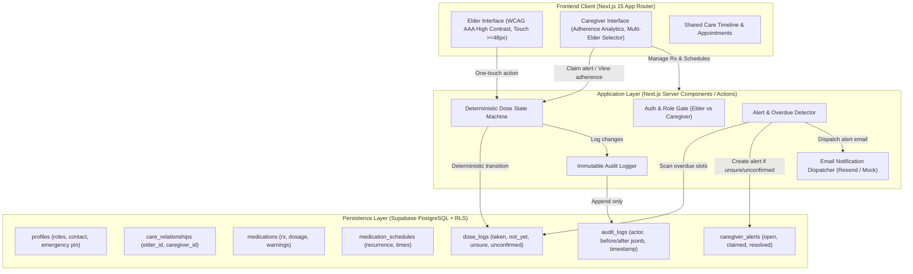
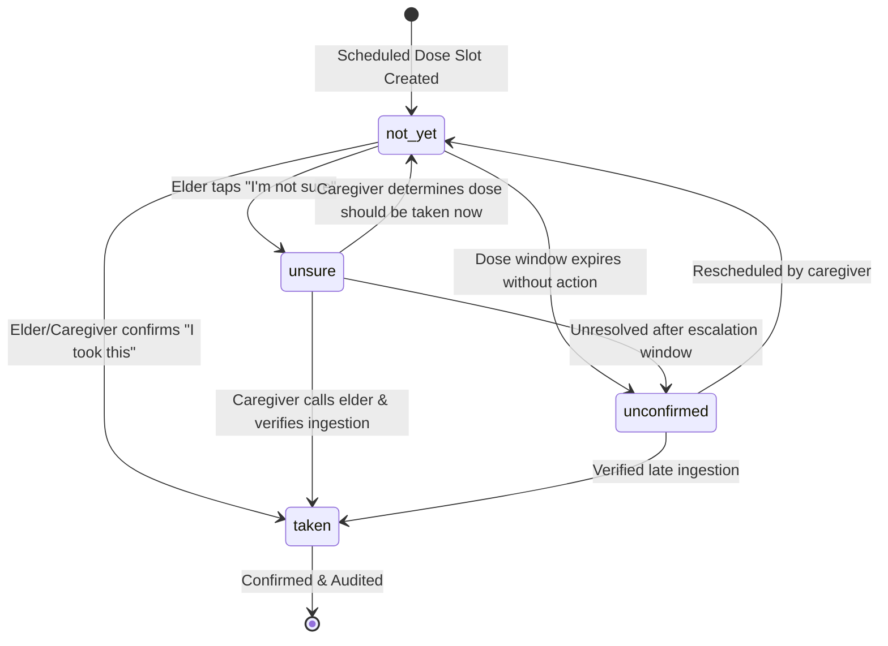

# CareLedger MVP Architecture

## 1. High-Level System Architecture

## 2. Deterministic Dose State Machine

### Critical Invariants:
1. **Never Ingest by Notification**: Scheduled notifications or email reminders NEVER transition a dose to `taken`.
2. **Actor Attribution**: Every transition records `logged_by` (user ID), `logged_at` (ISO timestamp), and optional notes.
3. **Escalation Trigger**: Transitions to `unsure` or timeout into `unconfirmed` automatically generate a `caregiver_alerts` record.

## 3. Database Schema & Row-Level Security (RLS)

- **`profiles`**: Stores `id` (references `auth.users`), `email`, `full_name`, `role` (`'elder'` | `'caregiver'`), `phone`, `emergency_notes`, `created_at`.
- **`care_relationships`**: Links `elder_id` and `caregiver_id`. Caregivers can only read/write data for elders with whom an `'active'` relationship exists.
- **`medications`**: Prescriptions tied to an `elder_id`. Only the elder or their authorized caregivers can view/manage.
- **`medication_schedules`**: Recurring schedules tied to a `medication_id` and `elder_id`.
- **`dose_logs`**: Individual daily scheduled instances. Stores `scheduled_for`, `status` (`'not_yet'`, `'taken'`, `'unsure'`, `'unconfirmed'`), `logged_by`, `logged_at`, `notes`.
- **`caregiver_alerts`**: Created for overdue or unsure doses. Tracks `status` (`'open'`, `'claimed'`, `'resolved'`), `claimed_by`, `claimed_at`, `resolved_at`, `resolution_notes`.
- **`appointments`**: Medical visits, transportation notes, and doctor info for an elder.
- **`audit_logs`**: Append-only log with `user_id`, `elder_id`, `action`, `entity_type`, `entity_id`, `old_values`, `new_values`, `created_at`.

## 4. Technology Stack & Tooling

| Component | Technology | Rationale |
|-----------|------------|-----------|
| Framework | Next.js 15 (App Router) | High performance React Server Components, Server Actions, modern routing |
| Language | TypeScript 5 | Strict type safety across dose state transitions and database models |
| Styling | Tailwind CSS | Fast, accessible utility styling for large touch targets and contrast |
| Database & Auth | Supabase PostgreSQL + RLS | Secure, relational data with row-level permission isolation |
| Testing | Vitest + React Testing Library | Fast unit and integration tests for state machine and RLS security rules |
| Deployment | Vercel | Seamless edge/serverless hosting with automated CI |
| Code Quality | CodeRabbit CLI | Autonomous code review and security auditing |
| Execution Loop | Ralph Loop | Test-driven, bounded iterative development |
